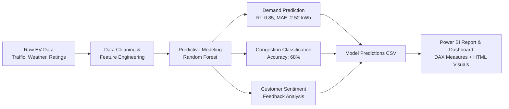

# EVCharge Intelligence ⚡🚗

> **A Predictive Analytics Framework for EV Charging Demand, Station Congestion, and Customer Feedback Analysis**


---

## 📌 Project Overview

**EVCharge Intelligence** is an end-to-end applied predictive analytics system designed to optimize electric vehicle (EV) charging infrastructure operations. As EV adoption rapidly increases across major metropolitan hubs, charging network operators encounter critical bottlenecks: peak-hour grid overload, station congestion, erratic queue times, and variable customer satisfaction.

This repository integrates:
1. **Machine Learning Predictive Models** for energy demand forecasting and station congestion classification.
2. **Sentiment & Feedback Analytics** to gauge user satisfaction across charging networks.
3. **Interactive Microsoft Power BI Reports & Dashboards** featuring tailored DAX measures and custom HTML UI visuals.
4. **Comprehensive Case Study Presentation & Reports** summarizing strategic insights and actionable recommendations.

---

## 📂 Repository Contents

| File / Folder | Description |
|---|---|
| 📊 [`EVCharge_Intelligence(APA).pbix`](./EVCharge_Intelligence(APA).pbix) | **Power BI Report File** with data model, visuals, and reports |
| 📓 [`EVCharge_Intelligence(APA).ipynb`](./EVCharge_Intelligence(APA).ipynb) | **End-to-End Jupyter / Google Colab Notebook** (Data cleaning, EDA, ML models, evaluation) |
| 🌐 [`EVCharge_Intelligence_Dashboard.html`](./EVCharge_Intelligence_Dashboard.html) | **Standalone Interactive HTML Dashboard** with filtering and KPIs |
| 📑 [`EVCharge_Intelligence_DAX_Measures.txt`](./EVCharge_Intelligence_DAX_Measures.txt) | **DAX Formulas & Measures** used in the Power BI model |
| 📊 [`EVCharge_Intelligence_Dataset.csv`](./EVCharge_Intelligence_Dataset.csv) | **Raw EV Charging Dataset** (timestamp, station, vehicle type, weather, demand, etc.) |
| 📈 [`EVCharge_PowerBI_Predictions.csv`](./EVCharge_PowerBI_Predictions.csv) | **Model Output & Predictions Dataset** consumed by Power BI |
| 📽️ [`EVCharge_Intelligence_APA.pptx`](./EVCharge_Intelligence_APA.pptx) | **Case Study Slide Deck** (Presentation) |
| 📄 [`EVCharge_Intelligence_APA.pdf`](./EVCharge_Intelligence_APA.pdf) | **Executive Summary & Report Document (PDF)** |

*(Note: Original source files and archives are preserved for full backward compatibility).*

---

## ⚙️ Workflow & System Architecture



---

## 🤖 Predictive Modeling Highlights

### 1. Energy Demand Forecasting (Regression)
- **Model:** Random Forest Regressor
- **Target:** `Energy_Demand_kWh`
- **Key Features:** Occupancy Rate, Queue Length, Vehicle Type, Connector Type, Temperature, Traffic Level, Electricity Price
- **Performance:**
  - **$R^2$ Score:** `0.847`
  - **MAE:** `2.52 kWh`
  - **RMSE:** `3.34 kWh`

### 2. Station Congestion Prediction (Multi-Class Classification)
- **Model:** Random Forest Classifier
- **Target:** `Congestion_Level` (`Low`, `Medium`, `High`)
- **Performance:**
  - **Accuracy:** `68.0%`
  - **Precision:** `0.685`
  - **Recall:** `0.680`
  - **F1-Score:** `0.679`

### 3. Customer Sentiment & Feedback NLP
- Analysis of customer textual feedback against numeric star ratings (`1.0` - `5.0`).
- Identification of service bottlenecks (e.g., connector faults, queuing delays, peak pricing frustration).

---

## 📈 Power BI Report (`.pbix`) Architecture

The included [`EVCharge_Intelligence(APA).pbix`](./EVCharge_Intelligence(APA).pbix) contains a multi-page interactive analytics suite:

### **Page 1: Energy Demand Intelligence**
- **Executive KPI Cards:** Total Sessions, Avg Actual Demand, Avg Predicted Demand, Demand MAE, High Demand Risk %.
- **Traffic Level vs. Demand Comparison:** Actual vs. predicted load variations across low, medium, and peak traffic periods.
- **Hourly Demand Profiles:** Diurnal demand curves to detect morning and evening charging spikes.
- **Weather Impact Matrix:** Ambient temperature and weather condition influences on battery charging demand.

### **Page 2: Congestion & Customer Experience**
- **City-Level Congestion Distribution:** Multi-city congestion breakdown across high-density EV corridors.
- **Sentiment & Rating Breakdown:** Cross-tabulation of user sentiment with station ratings.
- **Station-Level Demand & Congestion Matrix:** Granular identification of overloaded vs. underutilized charging nodes.

### **Key DAX Measures Included:**
- `Total Charging Records`: `COUNTROWS(EVCharge)`
- `Avg Actual Demand`: `AVERAGE(EVCharge[Energy_Demand_kWh])`
- `Avg Predicted Demand`: `AVERAGE(EVCharge[Predicted_Demand_kWh])`
- `Demand Prediction MAE`: `AVERAGE(EVCharge[Absolute_Demand_Error_kWh])`
- `High Demand Risk %`: Calculates percentage of sessions categorized as high demand risk.
- `Congestion Accuracy %`: Model prediction agreement with observed ground truth congestion.

---

## 🚀 How to Use & Reproduce

### 1. Run the Analytics Notebook
```bash
# Clone the repository
git clone https://github.com/CHAITANYA-THURANGI/EVCharge_Intelligence.git
cd EVCharge_Intelligence

# Install requirements
pip install numpy pandas scikit-learn matplotlib seaborn

# Open Jupyter Notebook
jupyter notebook "EVCharge_Intelligence(APA).ipynb"
```

### 2. Open the Power BI Dashboard
1. Ensure [Microsoft Power BI Desktop](https://powerbi.microsoft.com/desktop/) is installed.
2. Double-click [`EVCharge_Intelligence(APA).pbix`](./EVCharge_Intelligence(APA).pbix) to launch the report.
3. If prompted to refresh data sources, verify that [`EVCharge_PowerBI_Predictions.csv`](./EVCharge_PowerBI_Predictions.csv) is located in the working path.

### 3. View the Interactive Web Dashboard
Open [`EVCharge_Intelligence_Dashboard.html`](./EVCharge_Intelligence_Dashboard.html) directly in any modern browser (Chrome, Edge, Firefox, Safari) for immediate standalone visualization without requiring Power BI Desktop.

---

## 👤 Author
- **Chaitanya Thurangi**
- GitHub: [@CHAITANYA-THURANGI](https://github.com/CHAITANYA-THURANGI)
